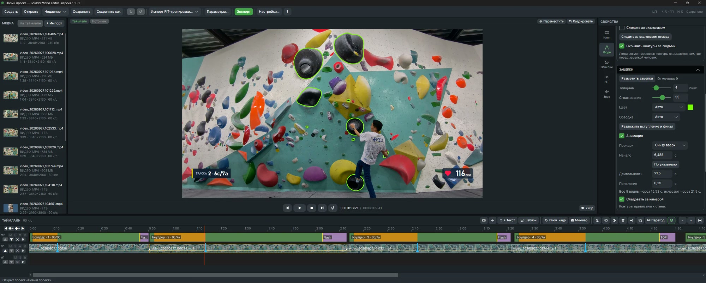
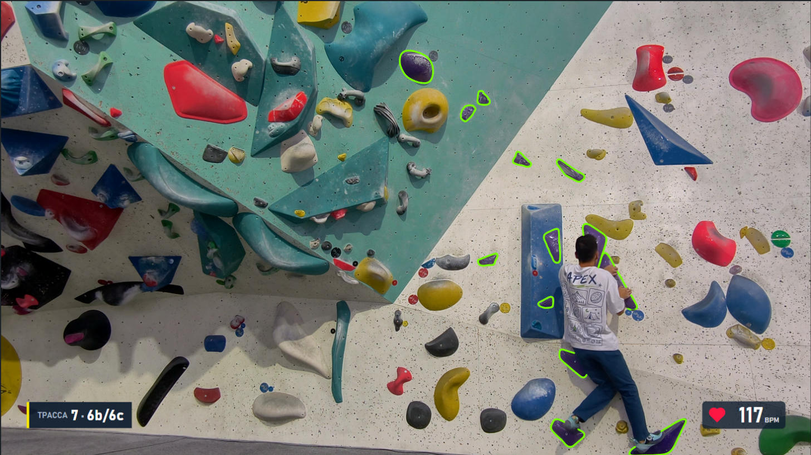
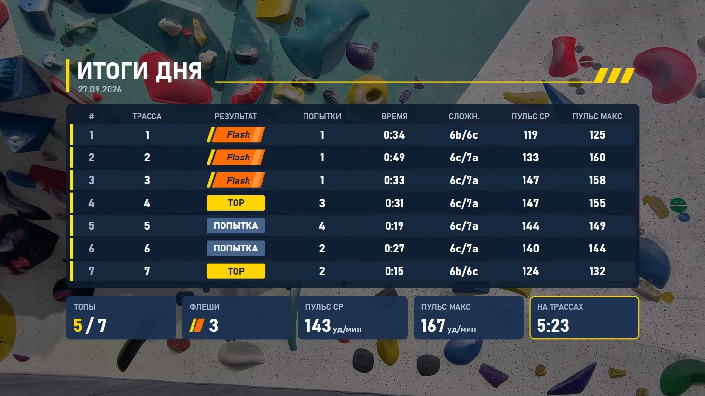
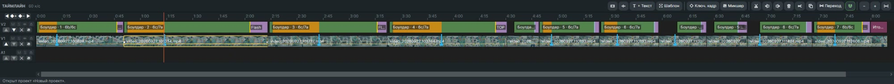
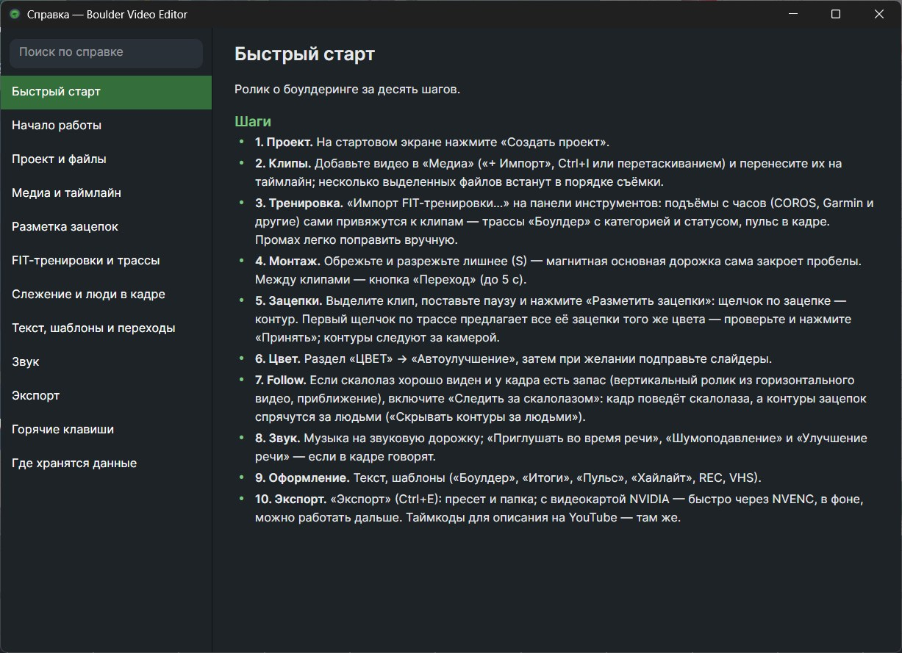

# Boulder Video Editor



**[English](#english) · [Русский](#русский)**

---

## English

A desktop video editor made for bouldering videos (Windows 10/11 x64). Its core is the work with **holds**: a click on a hold
gives its exact outline, a whole route is proposed from its first hold, the outlines follow the camera and hide behind the
climber, and the training from your watch (FIT) lays the climbs out on the clips by itself — with the heart rate.

### What it does

- **Holds and routes** — local AI (SAM 2.1): a click gives the hold's outline, smoothed without cutting its corners; «Suggest the
  route» proposes all holds of the route from its first one; the outlines appear one by one, follow the camera and hide
  behind people.
- **Training from the watch** — a FIT file (COROS, Garmin…): every climb is laid out on its clip — the green «Boulder» plate
  before the climb, the orange holds, the lilac result (TOP / attempt / Flash); the heart rate shown as it was recorded.
- **Templates** — «Boulder» (route, grade, result, heart rate), «Summary» (an animated board of the day: time on each route,
  attempts, heart rate, totals), «Heart rate», «Highlight», REC, VHS; Russian or English words on the frame.
- **Editing** — a magnetic main track, trim / split / «Trim left / right», a Source viewer, J / L cuts, transitions, keyframes,
  Follow (the frame follows the climber), colour correction and auto-enhance.
- **Text** — fonts, outline, background, italic, shadow, line spacing, a block width with word wrap (dragged in the Preview),
  saved styles, appearance animations.
- **Sound** — volume line, mixer, ducking under speech, noise reduction, voice enhancement.
- **Export** — MP4 / MOV / MKV in H.264, HEVC or AV1; presets «Fast» … «Maximum» (the default) and your own; with an NVIDIA
  card fast through NVENC, in the background; YouTube
  chapter timestamps (each route and the «Summary») to copy.
- Russian / English interface, in-app help (F1). Nothing is uploaded anywhere: the AI models run on your computer.

### Quick start

Download the installer (full or light web Setup) or the portable archive from
[Releases](https://github.com/Proskagit/boulder-video-editor/releases/latest) and make a video in ten steps:

1. **Project** — «Create project» on the start screen.
2. **Clips** — videos into «Media» (Ctrl+I) and onto the timeline.
3. **Training** — «Import FIT training…»: the climbs from your watch bind to the clips by themselves — routes and heart rate.
4. **Editing** — trim, split (S), «Trim left / right» (Q / W), the magnetic main track, «Transition» between clips.
5. **Holds** — «Mark holds»: a click on a hold gives its outline; the outlines follow the camera.
6. **Colour** — «COLOUR» → «Auto enhance».
7. **Follow** — «Follow the climber» when the frame has room: the frame follows the climber, the outlines hide behind people.
8. **Sound** — music, ducking under speech, noise reduction, voice enhancement.
9. **Design** — text and templates («Boulder», «Summary», «Heart rate», «Highlight»…).
10. **Export** — Ctrl+E, a preset («Maximum» by default); with NVIDIA — fast through NVENC, in the background; copy the YouTube timestamps.

Help on any step — F1 in the program.

### Screenshots

| | |
|---|---|
|  |  |
| *A route's holds marked from its first hold* | *«Summary» — the board of the day* |
|  |  |
| *The green / orange / lilac areas of a route and its result* | *In-app help (F1)* |

### For developers

.NET 8 · C# · Avalonia · CommunityToolkit.Mvvm · Serilog · FFmpeg / FFprobe. The time base is `MediaTime` (100 ns ticks).

```bash
git clone https://github.com/Proskagit/boulder-video-editor.git
cd boulder-video-editor
dotnet build
dotnet run --project src/App/App.csproj
dotnet test                      # AIVE_HEAVY_TESTS=1 adds the 4K export scenes
```

- **FFmpeg** is looked up at `Ffmpeg:FfmpegPath` / `Ffmpeg:FfprobePath` in `appsettings.json`, then on `PATH`.
- **The AI models** (≈ 1.2 GB) are installed with the Setup or from the portable folder; see `docs/AI_MODEL.md`.
- **The release** (Setup, web Setup, portable): `pwsh -File tools/distribution/New-Release.ps1` — `docs/DISTRIBUTION.md`;
  a portable folder alone: `pwsh -File tools/portable/Publish-Portable.ps1`.
- **Layout:** `src/Core` (domain, no UI / FFmpeg), `src/Timeline` (edits as undoable commands, playback), `src/Project`
  (`project.json`, autosave), `src/Video` / `src/Audio` / `src/Media` / `src/Export` (FFmpeg, WASAPI, export), `src/Vision`
  (ONNX models), `src/UI` (Avalonia views and view models), `src/App` (composition root); `tests/` — one suite per area.
- **Where the history lives:** `DECISIONS.md` (every decision), `docs/DEVELOPMENT_PLAN.md` (the phases), `ROADMAP.md`,
  `progress.md`, `ARCHITECTURE.md`.

---

## Русский

Настольный видеоредактор для роликов о боулдеринге (Windows 10/11 x64). Главное в нём — работа с **зацепками**: щелчок по
зацепке даёт её точный контур, вся трасса предлагается по первой зацепке, контуры следуют за камерой и прячутся за
скалолазом, а тренировка с часов (FIT) сама раскладывает подъёмы по клипам — вместе с пульсом.

### Что умеет

- **Зацепки и трассы** — локальный ИИ (SAM 2.1): щелчок даёт контур зацепки, сглаженный без срезания углов; «Предлагать
  трассу» отмечает все зацепки трассы по первой; контуры появляются по очереди, следуют за камерой и прячутся за людьми.
- **Тренировка с часов** — FIT-файл (COROS, Garmin…): каждый подъём раскладывается на свой клип — зелёная плашка «Боулдер»
  перед подъёмом, оранжевые зацепки, лиловый результат (TOP / попытка / Flash); пульс показывается таким, каким записан.
- **Шаблоны** — «Боулдер» (трасса, категория, результат, пульс), «Итоги» (анимированное табло дня: время на каждой трассе,
  попытки, пульс, итог), «Пульс», «Хайлайт», REC, VHS; надписи на кадре по-русски или по-английски.
- **Монтаж** — магнитная основная дорожка, обрезка / разрез / «Обрезать слева / справа», окно источника, J / L-склейки,
  переходы, ключевые кадры, Follow (кадр ведёт скалолаза), цветокоррекция и автоулучшение.
- **Текст** — шрифты, обводка, подложка, курсив, тень, интервал, ширина блока с переносом (тянется в Preview), сохранённые
  стили, анимация появления.
- **Звук** — линия громкости, микшер, приглушение под речь, шумоподавление, улучшение речи.
- **Экспорт** — MP4 / MOV / MKV в H.264, HEVC или AV1; пресеты «Быстрый» … «Максимальный» (по умолчанию) и свои; с видеокартой
  NVIDIA быстро через NVENC, в фоне; таймкоды
  глав YouTube (каждая трасса и «Итоги») — скопировать в описание.
- Интерфейс на русском и английском, справка в программе (F1). Ничего никуда не отправляется: модели ИИ работают на вашем
  компьютере.

### Быстрый старт

Скачайте установщик (полный или лёгкий web-Setup) или портативный архив со страницы
[Releases](https://github.com/Proskagit/boulder-video-editor/releases/latest) и сделайте ролик за десять шагов:

1. **Проект** — «Создать проект» на стартовом экране.
2. **Клипы** — видео в «Медиа» (Ctrl+I) и на таймлайн.
3. **Тренировка** — «Импорт FIT-тренировки…»: подъёмы с часов (COROS, Garmin…) сами привяжутся к клипам — трассы и пульс.
4. **Монтаж** — обрезка, разрез (S), «Обрезать слева / справа» (Q / W), магнитная основная дорожка, «Переход» между клипами.
5. **Зацепки** — «Разметить зацепки»: щелчок по зацепке — контур, контуры следуют за камерой.
6. **Цвет** — «ЦВЕТ» → «Автоулучшение».
7. **Follow** — «Следить за скалолазом», если у кадра есть запас: кадр ведёт скалолаза, контуры прячутся за людьми.
8. **Звук** — музыка, приглушение под речь, шумоподавление, улучшение речи.
9. **Оформление** — текст и шаблоны («Боулдер», «Итоги», «Пульс», «Хайлайт»…).
10. **Экспорт** — Ctrl+E, пресет (по умолчанию «Максимальный»); с NVIDIA — быстро через NVENC, в фоне; скопируйте таймкоды для YouTube.

Подсказка по любому шагу — F1 в программе.

### Скриншоты

| | |
|---|---|
|  |  |
| *Зацепки трассы, отмеченные по первой* | *«Итоги» — табло дня* |
|  |  |
| *Зелёная / оранжевая / лиловая области трассы и её результат* | *Справка в программе (F1)* |

### Разработчикам

Сборка, тесты, выпуск и устройство решения — в разделе [For developers](#for-developers) выше; вся история решений —
в `DECISIONS.md`, фазы — в `docs/DEVELOPMENT_PLAN.md`.
